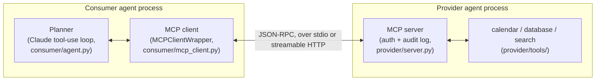

# Architecture notes

## Problem statement

Prove that a tool-provider agent and a tool-consumer agent, built as two
independent programs with no shared code and no direct function calls,
can interoperate correctly through the Model Context Protocol alone --
including when things go wrong, not just when the happy path runs once.

## Architecture



Plain-text fallback of the same diagram:

```
[ Consumer process ]                         [ Provider process ]
  Planner (Claude)                             MCP server (auth, audit log)
      |  tool-use decisions                        |  dispatch + validation
      v                                             v
  MCP client  <====  JSON-RPC (stdio /  ====>  calendar / database / search
  (MCPClientWrapper)   streamable HTTP)         (SQLite-backed tools)
```

The two boxes never call each other's functions and share no process,
memory, or import graph -- `shared/schemas.py` is the one deliberate
exception, and it's data (versioned Pydantic models), not behavior. As of
Phase 3 the connection between them is a real JSON-RPC exchange over
either a stdio pipe (development) or streamable HTTP (a genuinely separate
OS process, reachable only by URL).

## Five design decisions (Phase 2)

**1. Every tool call carries its own `token` argument, rather than relying
on transport-level auth.** stdio has no headers to put a bearer token in;
streamable HTTP does. Putting auth in the JSON-RPC payload itself, as an
ordinary argument every tool schema requires, means `provider/auth.py`
doesn't care which transport carried the call, and the exact same
`MCPClientWrapper` code works against either one without an `if transport
== "http": add_header(...)` branch anywhere. The trade-off is that every
tool's input schema is one field noisier than it would otherwise be --
solved by having `consumer/agent.py` strip `token` out of the schema
before Claude ever sees it (decision 3).

*Addendum, added when connecting this provider to a real MCP host (Claude
Desktop) instead of this project's own consumer:* a real host has no
equivalent of `consumer/agent.py`'s token-injection trick, so `token` is
optional on every tool, and the server substitutes a `PROVIDER_STATIC_TOKEN`
environment variable when it's omitted (before any validation), letting a
single-identity deployment work with zero client-side changes. This is
additive only -- every existing caller in this project still passes an
explicit token per call and is unaffected.

**2. Every tool result is a plain `{"ok": bool, ...}` JSON envelope,
never a raised protocol-level error.** `provider/server.py`'s `_dispatch`
catches every exception (`AuthError`, `ValidationError`,
`UnsafeQueryError`, anything else) and always returns a normal,
successful MCP result whose *body* says whether the call was accepted.
This turned out to matter more than expected: across one `mcp` major
version bump during this project, how a raised exception surfaces to the
client changed (`isError=True` content vs. a raised `MCPError`), and
field names changed case (`isError` -> `is_error`). None of that ever
touched this project's actual error-handling logic, because it was never
built on top of those transport-level details in the first place. The
consumer has exactly one shape to check (`payload.get("ok")`), on every
SDK version, on every transport.

**3. `consumer/agent.py` strips `token` out of the JSON schema handed to
Claude, and injects the real value right before dispatch.** The planner
picks *which* tool to call and *what* business arguments to pass; it has
no business seeing, generating, or reasoning about a credential. This is
a small function (`_strip_token_from_schema`), but it's the boundary that
keeps "the LLM decides what to do" and "the agent decides how to
authenticate" as two separate concerns -- worth naming as a decision
because it would be easy to skip and just let the model pass through
whatever token the system prompt mentioned.

**4. `consumer/mcp_client.py` keeps a small `_OUTPUT_MODELS` registry
mapping *known* tool names to the Pydantic model their response should
match -- a deliberate, narrow exception to "never hardcode tool names."**
Discovery (which tools exist, what arguments they take) is fully
runtime-driven, per the brief; but *validating a response's shape* is a
different concern from *discovering what's callable*, the same way a
typed HTTP client can discover endpoints via an OpenAPI document at
runtime and still have compile-time response models for the ones it
knows how to interpret. A tool discovered at runtime that isn't in this
registry isn't an error -- `_validate_output` passes it through
unvalidated -- so the exception doesn't silently break the "don't
hardcode" rule for anything genuinely novel; it only adds a safety net
for the tools this particular consumer build already understands.

**5. Schema-version compatibility is checked exactly once, at
`connect()` time, before any task runs -- not per tool call.** A version
mismatch isn't a property of one call that might succeed on retry; it's a
property of the whole session (this client cannot safely interpret
*any* response from this server), so it's checked once, fails fast, and
is the one failure mode that escalates rather than degrades (see
`consumer/agent.py`'s three-way failure strategy). Checking it lazily,
on first use, would have meant a task could partially execute against a
server the client doesn't actually understand before the mismatch
surfaced.

## Transport: stdio vs. streamable HTTP (Phase 3)

`MCPClientWrapper` takes a `transport` argument (`"stdio"` or
`"streamable-http"`) and branches only inside `connect()`, on which target
it hands to `mcp`'s unified `Client` class -- a `StdioServerParameters`
object or a URL string, respectively. Everything above that (discovery,
schema-version checking, the five typed failure modes, the entire
planning loop) is identical code, unaware of which transport is
underneath.

On the provider side, `provider/server.py`'s `main()` reads
`MCP_TRANSPORT`/`MCP_HOST`/`MCP_PORT` from the environment and calls
either `mcp.run(transport="stdio")` or `mcp.run(transport="streamable-http",
host=, port=)`. None of the tool/auth/audit code changed for this at all.

**What actually changed is process topology, not code.** Over stdio, the
provider is a subprocess the consumer's own client spawns and owns --
convenient for development, but not really two independent agents; one
process with a child. Over streamable HTTP, `consumer/demo.py`'s
`HttpServerProcess` (and the equivalent setup in
`tests/test_failure_modes.py`) starts the provider as a genuinely
unrelated OS process and polls a TCP port until it's accepting
connections before the consumer ever touches it. The consumer's only
knowledge of the provider is a URL; either side could be restarted, moved
to a different host, or replaced entirely without the other knowing, as
long as the URL and the schema contract hold.

**Timeouts behave differently underneath, even though the outer contract
doesn't.** `MCPClientWrapper.call_tool()` wraps every call in
`asyncio.wait_for(..., timeout=self._timeout)` regardless of transport,
and an absurdly small timeout (`0.00001s`) reliably fires the same
retry-then-degrade behavior on both. But what gets cancelled underneath
differs: over stdio, cancellation tears down an in-memory stream read
from a subprocess that keeps running the call to completion in the
background regardless. Over streamable HTTP, the same cancellation tears
down an in-flight HTTP request, sitting on top of `httpx`'s own internal
timeouts (a 30s connect/write/pool timeout and a notably long 300s read
timeout, since the server may hold a stream open for notifications).
Our microsecond-scale timeout fires long before either of those would, so
behavior looked identical here -- but a timeout in the tens-of-seconds
range could interact with `httpx`'s own connection pooling in ways a pipe
read never would. Also HTTP-specific: a client that gives up can leave
the *server* still finishing (and audit-logging as a success) a call
whose response is simply never read -- not possible the same way over a
subprocess pipe the client itself owns. This project's tools are fast and
side-effect-light enough that it wasn't a practical problem, but it's a
real difference worth flagging for anything with less benign side
effects (see "idempotency" below).

## A real failure, and how it was actually found (Phase 4)

**Symptom.** `pytest tests/test_failure_modes.py -v` ran 11 of 12 tests
to completion -- correctly -- then hung indefinitely, with no error, no
timeout, nothing. `Ctrl+C` showed the hang inside pytest-asyncio's own
per-test event-loop teardown, cancelling a task that never finished.

**First attempt, wrong diagnosis.** The hanging test was the one place
that opened a real connection, deliberately made it fail a version check,
and asserted the failure -- and it was missing an explicit `close()` call
after the expected exception. Added one. Didn't fix it.

**Second attempt, right instinct, wrong layer.** Reasoned that `close()`
itself might be the thing hanging -- a known category of issue with
asyncio subprocess transports on Windows' ProactorEventLoop -- and wrapped
it in `asyncio.wait_for(..., timeout=5.0)` so our own cleanup could never
block forever. A genuinely good defensive change (kept it), but it didn't
fix the hang: `close()` was returning fine. The hang was happening
*after* `close()` returned, discovered only later by pytest's own
teardown machinery.

**Isolating it.** Ran only the failing test, alone, with nothing before
it in that pytest session (`pytest ... -k schema_version_mismatch`). It
still hung. That ruled out an accumulation theory (repeatedly
spawning/killing subprocesses across ~20 prior tests exhausting some
Windows-specific resource) and pointed at something structural about
*this specific test's shape*, not the suite's size.

**Root cause.** `AsyncExitStack.enter_async_context(Client(target))`
happened inside `connect()`; the matching `aclose()` was deferred to a
separate `close()` call, invoked later, from the test body, after the
exception had already propagated out of `connect()` and been caught
elsewhere. Even though that's the same asyncio Task throughout, `anyio`'s
`CancelScope` nesting -- which `Client`'s internal task groups are built
on -- doesn't tolerate being closed from a resumed frame outside the
dynamic extent it was opened in. Deferring cleanup past that boundary
was the bug, not merely "cleanup happens eventually."

**Fix.** `connect()` now owns cleanup of anything it opened: wrapped in
`try/except BaseException: await self._close_exit_stack(); raise`, so a
failed `connect()` cleans up in the same call, before the exception ever
reaches a caller, rather than leaving a half-open connection for someone
else to close later. `close()` and `connect()`'s failure branch now share
that one method. The bounded timeout from the second attempt stayed, as
genuine defense-in-depth, but the structural fix -- not the timeout -- is
what actually resolved it, confirmed by isolated reproduction both before
and after.

**Why this one, not an easier one.** It's a good failure to have hit
because the wrong-but-plausible fixes (add a missing `close()`; bound a
suspicious `close()`) were each reasonable engineering responses to the
*symptom* and each genuinely improved the code, and neither touched the
*cause*. The lesson generalizes past this project: in async code built on
structured concurrency (`anyio` task groups, `asyncio.TaskGroup`), a
resource's cleanup isn't just a question of *whether* something eventually
closes it -- it's a question of *where in the call structure* that
happens, and "the caller will close it later" is not always equivalent to
"the owner closes it before returning."

## What would change for production

- **Auth**: `provider/auth.py`'s in-memory token table would become a
  real identity provider (OAuth2/JWT verification), with token
  expiry/rotation instead of static, indefinitely-valid strings.
- **Transport security**: streamable HTTP currently runs as plaintext on
  localhost. Production needs TLS termination at minimum, and mutual TLS
  between the two agents if they're meant to authenticate each other, not
  just the human behind them.
- **Rate limiting**: per-token and per-IP request limits on the provider,
  currently absent entirely.
- **Idempotency**: `calendar.create_event` isn't idempotent, and the
  consumer's own timeout-then-retry logic (Phase 2's failure mode 3)
  could in principle retry a call whose first attempt actually succeeded
  server-side but whose response the client gave up waiting for
  (flagged as an HTTP-specific risk above). Production writes need
  idempotency keys so a retried call is provably a no-op if the original
  went through.
- **Secrets management**: the toy token table and the (currently unused,
  optional) `SEARCH_API_KEY` environment variable would move to a real
  secrets manager rather than process environment variables.
- **Observability**: `audit_log.py`'s local JSONL file would become
  structured logs shipped to a real aggregator, plus distributed tracing
  with correlation IDs across the consumer/provider boundary -- right now
  there's no way to connect one specific planner decision to the audit
  log line it produced without reading timestamps by eye.
- **Schema evolution**: `SUPPORTED_MAJOR_VERSION` currently hard-refuses
  any newer major version. A real deployment would want graceful
  multi-version negotiation (the server advertising a range it can speak,
  the client picking the highest mutually supported version) rather than
  an all-or-nothing refusal.
- **Data layer**: SQLite-backed tools are fine for a toy dataset; a real
  provider would need a real multi-writer database with connection
  pooling and actual concurrent-write semantics.
- **Process supervision**: `subprocess.Popen`-and-poll-a-port (used by the
  demo script and test suite to stand up a real separate process) is fine
  for development and CI; production wants a real process manager
  (systemd, Kubernetes) with health checks and automatic restarts.
- **CI**: wired up (`.github/workflows/tests.yml`) -- the full pytest
  suite, including this file's regression tests, now runs automatically
  on every push and pull request across an Ubuntu/Windows x Python
  3.11/3.12 matrix, so a regression here is caught without anyone having
  to remember to run it by hand. `consumer/eval_harness.py`'s real-API
  report runs separately (`eval-harness.yml`), manually or weekly rather
  than per-push, since it costs real money to run.
